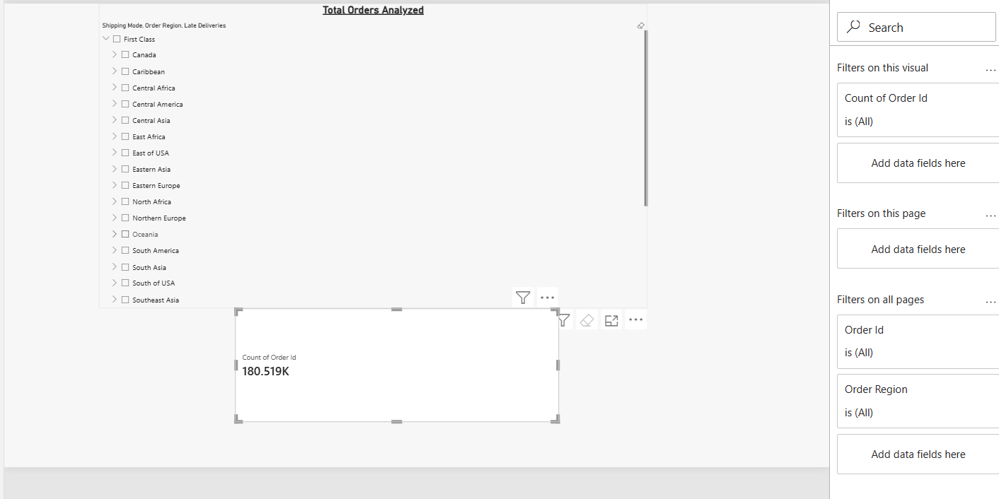
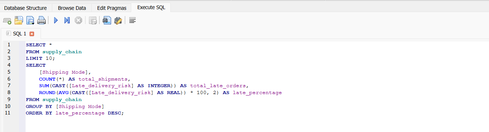

# Global Supply Chain & Late Delivery Performance Analysis

## Executive Dashboard

## Business Problem & SQL Analysis
Analyzed 180,000+ supply chain transactions using SQL to identify carrier bottlenecks and delivery risks.

### Key Finding:
* Standard Class shipping handles the bulk of order volume but accounts for the largest share of late delivery risks.
